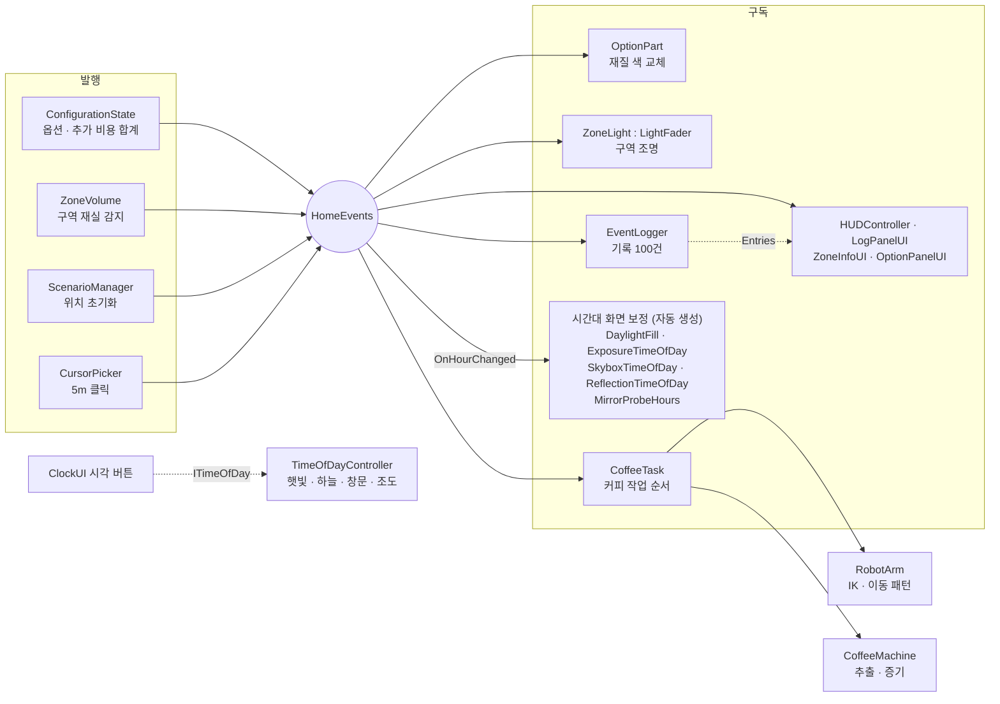

# 모델하우스 컨피규레이터

> 미래형 아파트를 1인칭으로 체험, 벽지·바닥재·주방 상판·소파·러그·그림·화분의 색을 바꾸며 인테리어를 꾸미는 Unity 컨피규레이터.

<!-- 시연 영상: 10/14 추가 -->
<!-- [](유튜브 링크) -->

| 항목 | 내용 |
| --- | --- |
| 팀 | COM (2인) |
| 기간 | 2026.10.06 ~ 2026.10.14 (10/13 12:30 기능 동결, 10/14 발표) |
| 엔진 | Unity `6000.4.0f1` (두 사람 같은 버전) |
| 렌더링 | URP (Forward+, 간접광 굽기 Baked Indirect, 반사 프로브, 포스트 프로세싱 Volume) |
| 언어 | C# |
| 공간 에셋 | [Modern Apartment](https://assetstore.unity.com/packages/3d/props/interior/modern-apartment-375248) (Zeps3D, URP 전용) — 저장소에 포함하지 않음, 각자 구매 후 Import |
| 플랫폼 | Windows 10/11 (64비트) |
| 요구사항 | [SRS v2.7](docs/SRS_COM_v2.7.docx) — 기능 요구사항 13개 (전부 Must) |
| 일정 | [WBS](docs/WBS_모델하우스_컨피규레이터.xlsx) |
| 검증 | [QA 체크리스트·버그 리포트·회귀 테스트](docs/QA_모델하우스_컨피규레이터.xlsx) |

---

## 팀과 역할

| 이름 | 역할 | 담당 | 핵심 기능 |
| --- | --- | --- | --- |
| 권오민 | 팀장 | 공간·옵션 표현·UI | 1인칭 투어, 구역·재실 조명, 옵션 색상 교체, 좌측 상단 메뉴·기록·시각 버튼 UI, 현관 조명·거울 반사 |
| 김찬중 | 팀원 · 기술 리드 | 이벤트·로봇팔·시간대 | 중앙 이벤트(HomeEvents), 커피 로봇(IK), 시간대별 햇빛과 조도, 커피 스테이션(머신·컵 보관대·받침대) |

---

## 주요 기능

| 기능 | 요구사항 |
| --- | --- |
| 1인칭 이동, 구역(현관·거실·주방·침실) 정보 표시 |
| 부분 클릭 옵션: 벽·바닥·주방 상판·소파·러그·그림·화분을 클릭하면 옵션 목록 |
| 구역에 들어가면 조명 켜짐, 나가고 3초 뒤 꺼짐 |
| 좌측 상단 메뉴 [옵션] [기록] [위치 초기화] [옵션 초기화] + 추가 비용 합계 |
| 커피 로봇: 클릭하면 컵 꺼내기 → 커피 머신에서 받기(5초) → 받침대에 놓기, [동작]·[일시정지]·[정지] |
| 이벤트 기록(밀리초), 위치 초기화(고른 옵션은 유지), 옵션 초기화(모든 파트 기본) |
| 옵션 7개 파트 색상 교체 |
| 시각 버튼으로 햇빛·하늘(시각별 스카이박스)·환경광·창문 밝기·반사와 구역 조도(lx) 변경 |


### 커피 로봇 동작

1. 로봇팔 클릭 또는 C 키 (빌드에서도 동작)
2. 받침대에 지난번 잔이 있으면 집어서 싱크대에 넣는다
3. 보관대의 다음 컵(1 → 2 → 3번)을 꺼내 커피 머신 추출구 아래에서 5초 동안 커피를 받는다
4. 커피가 담긴 컵을 받침대에 놓고 일자 자세로 돌아간다
5. 3번 컵까지 쓰고 다시 1번 차례가 되면 싱크대의 컵들이 빈 컵으로 보관대 제자리에 돌아온다

작업 중 조작 (강사님 피드백 10/12):

| 조작 | 키 | 동작 |
| --- | --- | --- |
| [동작] | C | 커피 만들기 시작 (로봇팔 클릭과 같음) |
| [일시정지] / [이어서] | X | 팔·추출 시간·김이 그 자리에서 멈춤, 다시 누르면 이어서 진행 |
| [작업 취소] | Z | 작업 취소. 들고 있던 컵은 집었던 자리에 내려놓고 팔은 대기 자세로 |

- 로봇팔에서 **1.8m 안**에서 로봇팔 쪽을 보면 화면 아래에 버튼과 지금 단계가 있는 상호작용 창(`CoffeeControlUI`)이 나타난다
- 로봇팔 앞 식탁에 키 안내판이 있다 (`Tools → COM → 로봇팔 사용 안내판 만들기`)
- 팔이 닿지 않는 컵(밑동 중심에서 수평 0.62m 밖)은 "작업 실패" → 컵은 보관대로, 팔은 홈 → 대기 (TC-18 시험: CoffeeTask Inspector ⋮ → `테스트: 팔이 안 닿는 컵`)

로봇팔은 실제 공장 로봇처럼 정해진 패턴으로만 움직인다: **물러나기 → 운반 자세로 접기 → 조인트 1만 회전 → 목표 위에서 펴기 → 직선 진입** (컵·받침대·싱크대는 위에서 아래로, 커피 머신은 앞에서 수평으로). 팔 닿는 범위는 밑동 중심에서 수평 0.62m까지(구조상 최대 0.65m).


### 시간대 화면 보정

집 벽·바닥 빛은 미리 구운 라이트맵이라 시각이 바뀌어도 그대로다. 그래서 낮에도 실내가 어둡고, 밤에도 낮 반사가 남았다. `TimeOfDayController`는 고치지 않고, 시각 버튼(`HomeEvents.OnHourChanged`)을 구독하는 보정 컴포넌트를 따로 두었다. 모두 씬에 붙일 필요 없이 Play·빌드 실행 때 자동으로 하나씩 생긴다.

| 컴포넌트 | 하는 일 |
| --- | --- |
| `DaylightFill` | 거실·주방·침실 구역 천장 아래에 그림자 없는 점광원을 격자로 깔고, 낮에는 켜고 밤(22시)에는 끈다. 색은 그 시각 햇빛 색을 흰색에 조금 섞음 |
| `ExposureTimeOfDay` | 실행 중 전역 Volume을 만들어 시각별 노출(Post Exposure)만 살짝 올린다 (실제 밝기는 DaylightFill 담당) |
| `SkyboxTimeOfDay` | 시각별 파노라마 하늘(`Resources/Skybox/Sky_XX`)로 바꾸고, 그림 속 해를 실제 햇빛 방향에 맞춰 돌린다 |
| `ReflectionTimeOfDay` | 구역 반사 프로브와 기본 반사 세기를 시각별 비율(06·18시 45%, 09시 80%, 12시 100%, 22시 10%)로 조절, 창유리 불투명도 낮 30%·밤 12% |
| `MirrorProbeHours` | 시각마다 미리 찍어 둔 거울 반사 사진 5장 중 그 시각 것만 켠다 |

---

## 조작법

| 입력 | 동작 |
| --- | --- |
| W A S D | 이동 (바라보는 방향 기준) |
| 마우스 오른쪽 버튼 누른 채 끌기 | 시점 회전 |
| 마우스 왼쪽 클릭 | 버튼, 옵션 부분(옵션 목록), 커피 로봇팔(커피 만들기) |
| 좌측 상단 메뉴 | [옵션] [기록] [위치 초기화] [옵션 초기화] |
| 우측 상단 시각 버튼 | 06:00 · 09:00 · 12:00 · 18:00 · 22:00 |
| C / X / Z | 커피 동작(로봇팔 클릭) / 일시정지·이어서 / 작업 취소 — C는 로봇팔 1.8m 안에서 로봇팔을 볼 때만 |
| F12 / F11 | 화면 캡처 / 이벤트 기록 저장 → `C:\Unity\COM_Evidence\` (QA 증거) |

---

## 구조

옵션 선택과 센서는 `HomeEvents`(중앙 이벤트 관리자)에 알리기만 하고, 재질·조명·로봇·UI는 `HomeEvents`를 구독만 한다. 시간대는 `ITimeOfDay` 인터페이스로 UI와 분리했다.



### 폴더 구조

```
Assets/
├── Scenes/        MainScene.unity (메인), Test_RobotArm.unity, Test_Sensors.unity
├── _Project/
│   ├── Scripts/
│   │   ├── Core/      HomeEvents, EventLogger, IClickable, ITimeOfDay, ScenarioManager, ZoneData, ZoneVolume
│   │   ├── Player/    PlayerController (1인칭), CursorPicker
│   │   ├── Options/   OptionCatalog, OptionItem, ConfigurationState, OptionPart, PartType
│   │   ├── Devices/   CoffeeMachine, CoffeeBrewEffect, LightFader, ZoneLight, TimeOfDayController,
│   │   │              DaylightFill, ExposureTimeOfDay, SkyboxTimeOfDay, ReflectionTimeOfDay, MirrorProbeHours
│   │   ├── RobotArm/  RobotArm, CoffeeTask
│   │   ├── UI/        HUDController, PanelUI, ClockUI, LogPanelUI, OptionPanelUI, ZoneInfoUI, CoffeeControlUI
│   │   ├── Tools/     EvidenceCapture
│   │   └── Editor/    상단 메뉴 COM·Tools/COM 세팅 도구
│   ├── Prefabs/       RobotArm (UR3 + 그리퍼)
│   ├── Data/          ZoneData 4개, OptionCatalog
│   ├── Materials/     로봇·커피 머신·받침대 재질
│   ├── Resources/     Skybox/Sky_06·09·12·18·22.mat (실행 중 Resources.Load로 불러옴)
│   ├── Textures/      Skybox/Sky_06·09·12·18·22.png (파노라마 360° 하늘)
│   └── Settings/      URP, 거울 반사 프로브 (MirrorProbes/ 시각별 .exr)
├── ArmRobot/      Unity 로보틱스 데모의 UR3·그리퍼 (ArticulationBody)
└── Zeps3D/        Modern Apartment (.gitignore로 제외, 각자 Import)
docs/              SRS v2.7, WBS, QA(체크리스트·버그 리포트·회귀 테스트), 클래스 다이어그램(drawio)
```

### 에디터 메뉴

| 메뉴 | 하는 일 |
| --- | --- |
| COM → 전체 세팅·점검 | 구역·플레이어·UI·시각 버튼·현관 조명 등 빠진 것만 채우고 점검 결과를 txt로 남김. 10/13부터 바닥 밝기 경계·간접광 세기 보정, 시각별 스카이박스 재질 생성, 거울 반사 시각별 굽기도 함께 실행 (몇 번 눌러도 같은 결과, 마지막에 저장하고 굽기) |
| Tools → COM → 옵션 카탈로그 만들기 (부록 A-7) | 옵션 목록·색·가격 에셋 생성 |
| Tools → COM → 커피 스테이션 만들기 (컵·머신) | 컵·커피 머신·CoffeeTask 생성과 연결 |
| Tools → COM → 로봇팔을 식탁 위에 올리기 | 로봇팔을 아일랜드 식탁 높이에 맞춤 |
| Tools → COM → 시간대 컨트롤러 붙이기 | TimeOfDayController 생성·연결 |
| Tools → COM → 로봇팔 색을 집 분위기에 맞추기 | 로봇팔을 오프화이트·차콜·브라스 톤으로 |
| Tools → COM → 커피 머신 새 디자인으로 바꾸기 | 에스프레소 머신을 기본 도형으로 새로 만듦 |
| Tools → COM → 찻잔 받침대 만들기 / 컵 보관대 만들기 | 받침대·컵 3개 보관대 생성, CoffeeTask에 연결 (다시 실행해도 위치 유지) |
| Tools → COM → 로봇팔 사용 안내판 만들기 | 로봇팔 앞 식탁에 C·X·Z 키 안내판 |

---

## 개발 환경 세팅

### 처음 만드는 사람

1. GitHub에서 빈 저장소 `com-modelhouse` 생성 (README, .gitignore 추가 체크 해제)
2. Unity Hub → Unity `6000.4.0f1` 설치 → New project → **Universal 3D** → 이름 `com-modelhouse`
3. 이 README, `.gitignore`, `.gitattributes`를 프로젝트 루트(`Assets` 폴더 옆)에 복사, `docs/SRS_COM_v2.7.docx` 추가
4. 버전 관리 설정: **Edit → Project Settings**
   - 왼쪽 목록의 **Version Control** → Mode: **Visible Meta Files** (Unity 6에서는 이게 기본값이라 이미 선택돼 있으면 그대로 둔다)
   - 왼쪽 목록의 **Editor** → Asset Serialization → Mode: **Force Text** (기본값이면 그대로 둔다)
   - Version Control은 Editor 안이 아니라 Project Settings 왼쪽 목록에 따로 있는 항목이다
5. Window → Package Manager → Input System, Cinemachine, ProBuilder, Animation Rigging 설치
6. Asset Store에서 **Modern Apartment**(Zeps3D)를 각자 구매 → Package Manager → My Assets → Import, Project 창에서 `Assets/Zeps3D`를 `Assets/ThirdParty/` 아래로 옮김
   - 데모 씬 라이트맵은 우리 씬에서 다시 굽는다
   - 커피 머신과 머그컵은 에셋에 없으므로 ProBuilder로 만든다
7. URP 설정: Rendering Path = Forward+, 고정 물체는 Static + 간접광만 굽기(Mixed, Baked Indirect), 구역마다 Reflection Probe, Global Volume(Tonemapping ACES, Bloom, SSAO). 햇빛은 시계로 실시간 변경
8. 첫 커밋

```bash
cd com-modelhouse
git init
git status                 # Library/, Temp/, Assets/ThirdParty/ 가 목록에 없는지 확인
git add .
git commit -m "chore: Unity 프로젝트 초기 설정 및 README"
git branch -M main
git remote add origin https://github.com/<계정>/com-modelhouse.git
git push -u origin main
```

9. Settings → Collaborators → 권오민 초대

### 받아서 여는 사람

```bash
git clone https://github.com/<계정>/com-modelhouse.git
```

Unity Hub → Add → Add project from disk → 클론한 폴더 선택 (Unity `6000.4.0f1`), Modern Apartment는 각자 Import

### 빌드

1. `develop`을 pull 받은 뒤 Unity에서 Console에 빨간 에러가 없는지 확인
2. File → Build Profiles → Windows → Build (씬 목록 맨 위 `MainScene`)
3. 만든 실행 파일로 시각 버튼 5개, 옵션 7개 파트, 커피 로봇, 위치·옵션 초기화를 한 번씩 확인

- 빌드하면 Unity가 `PC_RPAsset`, `GraphicsSettings`, `ProjectSettings`, `Build Profiles/`를 자동으로 다시 저장한다. 의도한 변경이 아니면 기능 커밋에 섞지 않는다
- 런타임 스크립트(`Editor/` 폴더 밖)에서 에디터 전용 API를 쓰면 에디터 Play는 되고 빌드만 실패한다. `#if UNITY_EDITOR`로 감싸거나 실행 중에도 있는 API로 바꾼다 (트러블슈팅 10/14 참고)

---

## 협업 규칙

| 항목 | 규칙 | 예 |
| --- | --- | --- |
| 브랜치 | `main`은 발표용 최종본. 통합은 `develop`, 기능은 `feature/이름-기능`에서 작업 후 `develop`으로 PR | `feature/chanjung-robot-finish` |
| 커밋 | `타입: FR번호 한 줄 요약` (feat, fix, refactor, docs, chore) | `feat: FR-13 커피 로봇 컵 보관대·싱크대` |
| 리뷰 | PR은 상대방이 리뷰 후 머지. 오너가 설명하지 못하는 코드는 미완성 | |
| 씬 | `MainScene.unity`는 둘 다 수정하므로 작업 전 `develop`을 pull, 씬 충돌은 오브젝트 단위로 합친다 | |
| 마감 | 매일 19:00 기록 공유 전에 PR 머지 | |

---

## 일정

작업 가능 시간: 09:30 ~ 19:10 (점심 12:20 ~ 13:20)

| 날짜 | 단계 | 끝나면 있어야 할 것 |
| --- | --- | --- |
| 10/6 (화) | 기획·설계 | 기획서, 클래스 설계, SRS |
| 10/7 (수) | 에셋·씬 구축 | Modern Apartment 임포트, 4구역, 조명 굽기, 로봇팔 리그 |
| 10/8 (목) | 기능 구현 1 | 1인칭 이동, 옵션 색상 교체, 커피 로봇 IK |
| 10/12 (월) | 기능 구현 2 | Must 전부 동작 (MVP), 시간대, 커피 스테이션, 통합 |
| 10/13 (화) | 폴리싱·빌드 | 12:30 기능 동결, 빌드 테스트 1, 시간대 화면 보정 (강사님 피드백) |
| 10/14 (수) | 발표 | 빌드 테스트 2 (빌드 에러 수정 후 성공), 시연 영상, 발표, 회고 |

---

## 트러블슈팅

| 날짜 | 문제 | 원인 | 해결 |
| --- | --- | --- | --- |
| 10/12 | 씬에 로봇팔이 안 보임 | 프리팹 안 UR3가 19m 떨어진 곳에 있었음 | UR3 위치를 0으로, 데모용 식탁은 끔 |
| 10/12 | 로봇팔이 클릭되지 않음 | 로봇 마디가 Default 레이어, 커서는 Interactable 레이어만 검사 | 마디 레이어를 Interactable로 |
| 10/12 | 시각 버튼을 눌러도 밤에 창문이 밝음 | 창문 유리 재질 `m_glass`가 HDR 발광(약 13) | 시각마다 실행 중 복사본의 발광 세기를 낮춤 |
| 10/12 | 커피 머신이 엉뚱한 곳에서 컵을 받음 | 머신 몸체·추출구를 옮겨 컵 자리와 어긋남 | 시작할 때 컵 자리를 추출구 바로 아래로 자동 정렬 |
| 10/12 | 로봇팔이 식탁·머신을 뚫고, 마디끼리 겹침 | 매번 IK를 여러 번 풀어 고르는 방식이라 자세 계열이 바뀌며 엉뚱한 길로 이동 | 정해진 이동 패턴(물러나기 → 접기 → 조인트1 회전 → 펴기 → 직선 진입)으로 재설계 |
| 10/12 | 바꾼 Inspector 기본값이 적용 안 됨 | 씬에 저장된 값이 코드 기본값보다 우선 | 의미가 바뀐 값은 새 필드 이름으로 |
| 10/12 | 커피 1회가 30초 넘음 (지난 잔 정리 포함 최대 61초) | 싱크대 정리 단계 추가, 관절 회전 속도 90°/초 | 회전 속도 120°/초, SRS v2.6에서 기준을 빈 받침대 30초·정리 포함 60초로 분리 |
| 10/12 | 시각 버튼을 누를 때 프레임이 튐 | 환경광 갱신 때 기본 반사 큐브맵(1024)도 다시 그림 (추정) | 반사 해상도 128로, 적용 시간·프레임을 콘솔에 남겨 확인 |
| 10/12 | 커피 머신 앞에서 컵이 물받이 그릴에 끌림 | 컵 자리 높이가 그릴 윗면보다 낮았음 | 시작할 때 컵 자리를 그릴 윗면에 맞춤 |
| 10/12 | 두 사람이 고친 MainScene 병합 충돌 | 둘 다 새 오브젝트를 추가해 파일 안 같은 위치에 들어감 | 오브젝트(fileID) 단위로 합치고 참조 끊김 0개 확인 |
| 10/12 | 시간대마다 로봇팔 색이 바뀜 | 움직이는 물체는 시간대별 햇빛·환경광을 그대로 받음 | 로봇팔을 햇빛에서 제외(렌더링 레이어), 실내 환경광 고정 |
| 10/12 | X 일시정지가 안 먹을 때가 있음 | 팔이 목표에 이미 닿은 채 멈추면 미세 보정이 끝나 다음 단계(추출·놓기)로 넘어감 | 일시정지가 풀릴 때까지 대기, 추출·놓기 직전에도 확인 |
| 10/12 | "Reduced additional punctual light shadows resolution" 경고 | 현관 점광원 그림자(6면)가 그림자 아틀라스(2048)에 안 들어감 | 현관 조명 그림자 끔 (다른 구역 조명과 같게, FPS 개선) |
| 10/12 | 거울 반사가 COM 세팅 후 깨짐 | 품질 세팅이 거울 프로브(Custom)를 Baked로 바꿈, 이름에 번호가 붙어 중복 생성 | Custom 프로브 건너뛰기, 거울 이름 기준으로 1개만 |
| 10/13 | 재질형 옵션 뒤 기본 옵션을 골라도 원래대로 안 돌아옴 | 색상형 기본 옵션이 지금 칸의 재질(바꾼 재질)을 원본으로 착각 | 처음 재질을 기억해 두고 항상 다시 끼움 |
| 10/13 | 낮인데 거실·주방·침실이 어두움 | 벽·바닥 빛은 구운 라이트맵이라 시각과 무관, 햇빛은 창가 바닥에만 닿음. 노출만 올리면 하얗게 뜸 | 간접광 세기 1.5 → 2.0, 구역 천장 아래 채광 점광원(`DaylightFill`), 노출은 살짝만(`ExposureTimeOfDay`) |
| 10/13 | 광택 바닥에 체크무늬 밝기 경계, 프로브 경계가 직선으로 보임 | 바닥이 넓어 라이트맵 텍셀이 성김, 구역 반사 프로브 박스 경계 | `sm_floor` Scale in Lightmap 2 + Stitch Seams, 구역 프로브 Blend Distance 1m + Box Projection |
| 10/13 | 밤에도 거울·창·광택 바닥에 낮 반사가 비침 | 반사 프로브는 낮에 한 번 구운 사진 | 시각별 반사 세기 비율(`ReflectionTimeOfDay`), 거울은 시각마다 따로 구워 둠(`MirrorProbeHours`) |
| 10/13 | 밤에 천장 조명을 받은 창유리가 흰 벽처럼 보임 | `m_glass`가 흰색 60% 불투명 + SrcBlend One이라 알파를 낮춰도 색이 더해짐 | 실행 중 복사본을 일반 알파 블렌드로, 불투명도 낮 30%·밤 12% |
| 10/13 | 거울 프로브 사진만 바꾸면 화면에 반영 안 됨 | URP Forward+가 반사 프로브를 아틀라스에 올려 재사용 | 시작할 때 시각별 프로브를 만들어 두고 시각 버튼마다 그 시각 것만 켬 |
| 10/14 | 빌드 실패: CS1061 `'Light' does not contain a definition for 'lightmapBakeType'` | `DaylightFill`이 에디터 전용 속성 `Light.lightmapBakeType`을 실행 중에 씀 → 빌드(Player)에는 없는 속성이라 에디터 Play는 되고 빌드만 실패 | `#if UNITY_EDITOR`로 감싸고, 빌드에서도 동작하는 `bakingOutput`(Realtime, isBaked = false)으로 실시간 빛 지정 |

---

## 코드 리뷰 · 멘토링 기록

| 날짜 | PR / 주제 | 리뷰 내용 | 결과 |
| --- | --- | --- | --- |
| 10/12 | 강사님 피드백 | 정지·일시정지·동작 버튼, 위치/옵션 초기화 분리, 로그 저장·표시 분리, 조명 공통 클래스, 팔 상태와 작업 단계 분리 | PR #7·#8 반영 |
| 10/12 | 전체 코드 리뷰 (스크립트 47개) | 일시정지 중 다음 단계 진행, 정지 시 컵 위치, 에디터 메뉴 재실행 시 깨짐, 거울 프로브 Baked 변환 | PR #8·#9 반영, 컴파일 경고 0 |
| 10/13 | 오민 10/13 작업 | 개인 작업 메모 제외, QA 표 하나로 통일 | feature/chanjung-qa |
| 10/13 | 시연 리허설 피드백 | 조작 패널은 1.8m 안에서 로봇팔을 볼 때만, [정지] → [작업 취소], 싱크대 컵 자리 분산, 컵 지름에 맞춰 그리퍼 닫기 | 반영 |
| 10/13 | 강사님 피드백 (시간대 화면) | 낮인데 실내가 어둡다, 바닥 밝기 경계, 시간대별 하늘 배경 | 채광 조명·간접광 세기·노출 보정, 바닥 라이트맵·프로브 섞임, 시각별 스카이박스·거울 반사 반영 |
| 10/14 | 빌드 테스트 2 | 에디터 전용 API(`lightmapBakeType`)를 런타임 스크립트에서 사용 | `DaylightFill` 수정 후 develop 머지, 빌드 성공 |

---

## 회고

<!-- 10/14 작성: 잘한 점, 아쉬운 점, 다음에 바꿀 점 -->
